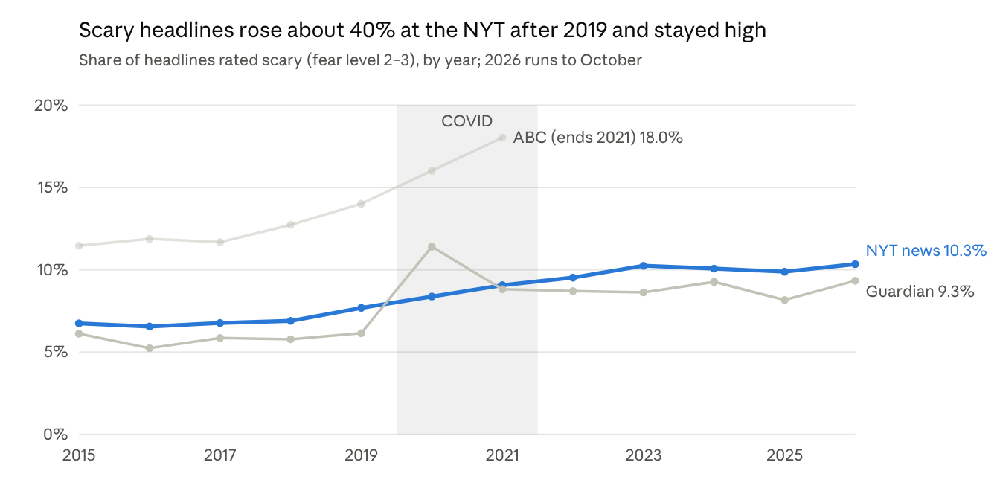
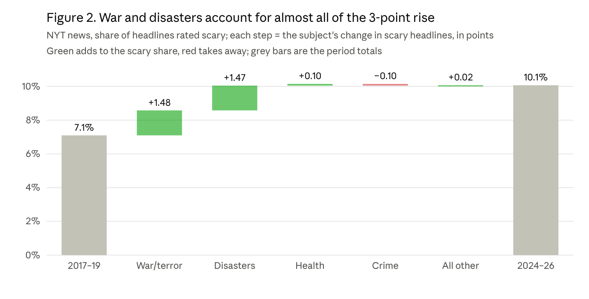

# Fear in the Headlines

**Is the news getting scarier, and why?** This project scores 3.35 million headlines (NYT, Guardian, ABC Australia, 2003–2026) for fear with a small model trained on one reader's written fear scale.

> **Status: ongoing.** This is a working paper and research code, not a finished product.

## What we found

- **Scary headlines rose and stayed up.** NYT news went from 7.1% (2017–19) to 10.1% (2024–26), +3.0 points (95% CI 2.7 to 3.3). The Guardian also rose 3.0 points, from 5.9% to 8.9% (CI 1.9 to 3.9).
- **COVID was a spike.** Health news surged in 2020–21, then returned to normal by 2024.
- **War and disasters drive the lasting rise.** About 90% of the NYT rise comes from what gets covered, not how it's told. In the Guardian it's about two-thirds.
- **Opinion pages had no lasting rise.**

"Scary" means level 2 or 3 on the [fear scale](docs/codebook.md). Start with the **[final report](docs/final-report.md)**, or read the [working paper](docs/paper.md) for the full method.

## How well the model works

Each sealed test has 300 unseen NYT headlines, labelled blind and opened once.

| Test | Agreement (weighted κ) | Exact level | Scary caught | False alarms on tricky calm news |
|---|---|---|---|---|
| NYT 2003–21 | .93 | 81% | 94% | 17% |
| NYT 2022–26 | .88 | 77% | 87% | 23% |

Two independent labellers agreed at κ .93. The weakest level is mild news (level 1), where only about half are right.

## Repository map

| Path | Contents |
|---|---|
| [`docs/final-report.md`](docs/final-report.md) | What we accomplished, the findings and what's next |
| [`docs/paper.md`](docs/paper.md) | Working paper |
| [`docs/results-covid.md`](docs/results-covid.md) | Detailed results tables for the COVID-era analysis |
| [`docs/codebook.md`](docs/codebook.md) | The fear scale and its rules |
| [`docs/plans/`](docs/plans) | Plans written before results were computed, with their outcomes |
| [`pipeline/`](pipeline) | The scripts behind the final model and analysis (see below) |
| [`noesis_fear/`](noesis_fear) | Scoring code and small model head files |
| [`results/`](results) | Aggregate results as JSON |

### Pipeline

| Stage | Scripts |
|---|---|
| 1. Collect | `outlets_fetch`, `guardian_alltopics`, `guardian_targeted`, `recent_fetch` |
| 2. Build labels and sealed tests | `build_u1_corpus`, `make_synthetic`, `prep_scary_test`, `prep_scary_test4`, `prep_scary_test5`, `prep_v7f_data` |
| 3. Train | `v10_model`, `train_v12` (teacher), `build_fear_v7e` (student), `build_subject`, `build_subject_rules` |
| 4. Evaluate | `u1_eval`, `eval_scary_sealed4`, `eval_v7f_sealed5` |
| 5. Score and analyse | `score_all_v7e`, `analysis_covid` |

## What's not included, and what that means

- **Headline text, labels and per-headline scores** are left out, to respect the outlets' terms.
- **The encoder weights (88 MB)** aren't published yet, so `noesis_fear` can't score text on its own.

So you can read the method, inspect the code and check the aggregate results, but you can't re-run training or scoring from this repo alone. Scripts expect local data under `data/`. To collect headlines, copy `.env.example` to `.env` and add your own NYT and Guardian API keys.

## Limits

One reader's scale. Headlines only. Most labels came from an AI labeller following the written codebook. Only the NYT and the Guardian run past 2021. About 1 subject in 3 is wrong (the conclusions also hold with the outlets' own tags). The paper's references were compiled from memory and are still being checked.

## Data sources and licence

NYT Archive API, Guardian Content API, [A Million News Headlines](https://www.kaggle.com/datasets/therohk/million-headlines) (ABC) and [News Category Dataset](https://www.kaggle.com/datasets/rmisra/news-category-dataset) (HuffPost, CC BY 4.0). Code is under the [MIT licence](LICENSE), which doesn't cover third-party data. See [SECURITY.md](SECURITY.md) to report a security issue.
