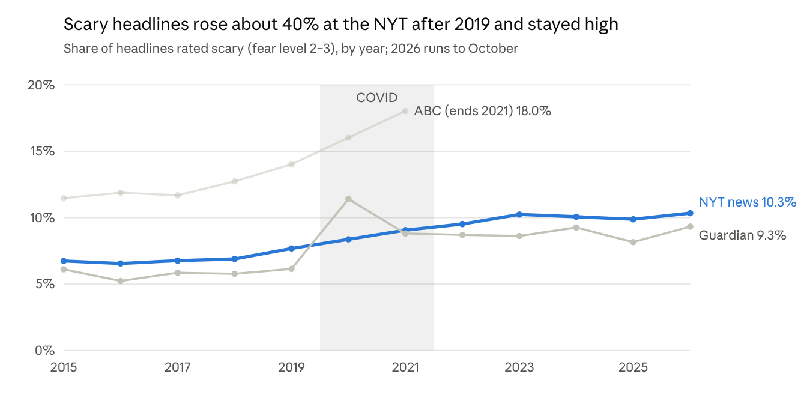
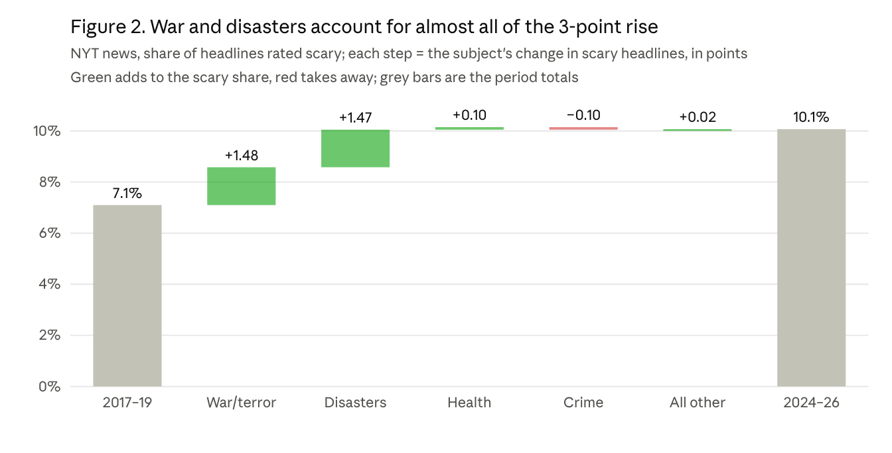

# Fear in the Headlines: Measuring News Fear on a Reader's Own Scale, 2003–2026

Rahheb Shaikh · 27 October 2026 · Final report, project ongoing

## Abstract

Did the news become more frightening after COVID-19, and if so, why? We scored 3.35 million headlines from the New York Times (2003–2026), the Guardian (2003–2026) and ABC News Australia (2003–2021) for fear on a 0–3 scale defined by one reader's explicit codebook. A compact sentence model, distilled from a larger teacher trained on about 3,900 labelled headlines, reproduced the reader's levels on unseen sealed test sets with quadratic-weighted κ of .93 (2003–21 news) and .88 (2022–26 news), close to the agreement between two independent labellers (κ .93). The share of scary headlines (level 2 or 3) in NYT news rose from 7.1% in 2017–19 to 10.1% in 2024–26 (+3.0 points, 95% CI 2.7 to 3.3); the Guardian rose by the same amount (+3.0, CI 1.9 to 3.9). COVID produced a temporary spike in frightening health coverage that had faded by 2024. A shift-share decomposition attributes about 90% of the lasting NYT rise to agenda (more coverage of war, terrorism and disasters) rather than to framing (how frightening each subject is made to sound). Opinion pages showed a COVID bump but no lasting rise. We release the method and codebook so the measure can be reused.

## 1 Introduction

Headlines are the part of the news most people actually read, and a frightening headline shapes perceived risk even when the article beneath it is measured. Whether news has become more frightening matters for public anxiety, trust in media and how societies weigh real risks.

### 1.1 The problem with existing measures

Most large-scale studies measure sentiment or general negativity with lexicons or classifiers trained on generic emotion labels. Those tools confuse figurative harm ("a crushing defeat") with real threat, treat a court verdict over an old killing like the killing itself, and cannot say whose sense of fear they encode. We instead measure fear on an explicit, written scale anchored to one reader's judgement, and test the model against that scale on data it has never seen.

### 1.2 Research questions

1. **RQ1.** Did the share of frightening headlines change before, during and after COVID-19 (2017–2026)?
2. **RQ2.** Which subjects carry the frightening headlines, and did their share of coverage change?
3. **RQ3.** Is any change driven by agenda (which subjects are covered) or by framing (how frightening a given subject is made to sound)?

### 1.3 Contributions

- A written four-level fear codebook with tie-break rules, and a labelled corpus of about 3,900 headlines on that scale.
- An offline, phone-sized fear model (MiniLM, about 90 MB) that matches the scale at near-human agreement on sealed tests, plus a 10-subject classifier sharing the same encoder.
- A scored analysis of 3.35 million headlines across three outlets and 24 years, and a pre-registered-style analysis of the COVID era with day-clustered uncertainty and a shift-share decomposition.

## 2 Background

### 2.1 Negativity and fear in the news

Audiences attend more to negative news than to positive news (Soroka & McAdams, 2015; Trussler & Soroka, 2014), and negative words raise click-through on headlines (Robertson et al., 2023). Cultivation research argues that heavy exposure to violent media fosters a "mean world" view (Gerbner & Gross, 1976). Long-run studies of headline sentiment report rising negativity and fear-related emotion in US outlets from 2000 to 2019 (Rozado, Hughes & Halberstadt, 2022). These studies use generic sentiment or emotion labels; ours uses a fear-specific scale tied to real threat.

### 2.2 Agenda versus framing

Agenda-setting holds that the media shape what audiences think about by choosing what to cover (McCombs & Shaw, 1972). Framing concerns how a covered issue is presented (Entman, 1993). A rise in frightening headlines could come from either: more coverage of threatening subjects, or more alarming treatment of the same subjects. A shift-share decomposition separates the two.

### 2.3 Measuring emotion in text

Lexicon methods are cheap but blind to context, such as "shooting" in basketball, or a verdict long after a crime. Sentence encoders (Reimers & Gurevych, 2019) capture context; large encoders such as MPNet (Song et al., 2020) are accurate but heavy, and knowledge distillation (Hinton, Vinyals & Dean, 2015) transfers their judgements into small models such as MiniLM (Wang et al., 2020). Ordinal scales are best trained with ordinal-aware losses (Cao, Mirjalili & Raschka, 2020) and evaluated with weighted kappa (Cohen, 1968).

## 3 Data

### 3.1 Sources

| Source | Years | Headlines after deduplication | Access | Design |
| --- | --- | --- | --- | --- |
| New York Times | Jan 2003 – Oct 2026 | 1,818,830 | NYT Archive API | Full archive; news, opinion and other material types |
| ABC News (Australia) | Feb 2003 – Dec 2021 | 1,244,182 | Public "A Million News Headlines" dataset | Full set; ends 2021 |
| The Guardian | Jan 2003 – Oct 2026 | 289,833 | Guardian Content API | One random day per month (all topics) plus complete archives for 10 threat-related tags |
| HuffPost News Category | 2012 – 2022 | 210,000 | Public dataset, CC BY 4.0 (Misra, 2022) | Used only to train the subject classifier |

### 3.2 Collection

All data came through official APIs or openly licensed datasets, within published rate limits; no social-media platform was scraped. API responses were cached so every collection run is reproducible. The 2022–2026 extension was collected on 27 October 2026.

### 3.3 Deduplication

NYT and Guardian articles were deduplicated by article ID; Guardian random-day items without IDs, and ABC items, by date plus headline. A Guardian article reached by both the random-day and the tag designs is kept once, with both designs recorded. Headlines repeated five or more times within a source (for example "Corrections" or column names) are flagged as generic and excluded from the main analysis. Any headline used in training or in a test set was excluded from every other split.

### 3.4 Sampling designs and gaps

- Only the Guardian random-day sample is used for shares, because the tag archives deliberately over-sample threat topics.
- ABC ends in 2021, so post-COVID claims rest on the NYT and the Guardian.
- The NYT Archive API returned only about 700 articles for January 2026, against about 4,000 in a typical month, and 2026 runs to October.
- In 2025 the NYT changed its document-type label from "article" to "Article"; all filters are case-insensitive.

## 4 Measuring fear

### 4.1 The fear scale (codebook U1)

The question for every headline is: reading only this headline, how threatened or anxious would the reader feel? Levels are integers 0–3; when unsure between two levels, the lower is chosen.

| Level | Meaning | Typical cases | Example |
| --- | --- | --- | --- |
| 0 No fear | No threat to people | Sport, arts, procedure; rescued or found safe; figurative harm; animals only; natural-death obituaries | "Passengers escape plane inferno" |
| 1 Mild concern | Harm that is contained, distant or past | Court cases, charges and verdicts over killings; inquiries; aftermath and costs; drought | "Man who killed two women jailed" |
| 2 Clear fear | A real, current threat | A single accidental death; a missing person with the search ongoing; injuries; a fugitive on the run; large job losses | "River search fails to find missing driver" |
| 3 Alarm | Death that has happened, or mass danger | Several deaths; any violent death or shooting; mass-casualty disasters | "Car bomb kills 5 in Iraqi market" |

Headlines that sit between 2 and 3 (a search called off with people presumed dead, an explainer about a shooting) are scored 3 when labelled as integers; in analysis a model score of 2.5 or more counts as 3. Appendix A lists every rule.

### 4.2 Labelling and reliability

1. **Anchor ratings.** The reader rated 100 headlines by hand. A context check proposed 21 corrections where the reader lacked context (for example, a well-known disaster's death toll); the reader accepted all 21. The codebook was written from these ratings.
2. **Scale gap.** Generic AI raters scored about 0.44 levels higher than the reader on the same headlines (their 3 matched the reader's 2.2). This is why the model is trained on the reader's scale rather than on generic emotion labels.
3. **Corpus labels.** Further headlines were labelled with the codebook by an AI labeller (Claude), blind to all model scores, with doubtful cases collected and settled by the reader's rules. The training corpus holds about 3,900 headlines (3,118 train, 782 development, stratified by source and level).
4. **Reliability.** A second, independent labeller re-rated 150 labelled headlines blind: exact agreement 86%, quadratic-weighted κ .93. Label noise is therefore not the main limit on accuracy.

### 4.3 Model

The production model is small enough to run offline on a phone; a larger model supervises it during training.

1. **Teacher.** A sentence encoder (all-mpnet-base-v2; Song et al., 2020) fine-tuned with an ordinal (CORAL) head, a pairwise similarity loss and synthetic minimal pairs, which are edited headlines that change one factor, such as a death becoming a rescue. It is trained on the reader-scale labels (weight 2) plus earlier generic-rater labels (weight 0.5). Five seeds are averaged.
2. **Student.** MiniLM-L6 (Wang et al., 2020; inputs up to 32 tokens) distilled by mean-squared error on the teacher's scores for about 300,000 unlabelled ABC headlines, with the reader-scale labels added as direct targets (weight 3). A story-type head is trained jointly, and the final fear head is a ridge regression on the student's embeddings.
3. **Cut-points.** The continuous score is mapped to levels by three cut-points. The 1/2 cut maximises recall of scary headlines subject to at most 15% false alarms on "tricky calm" headlines (calm headlines containing harm words); the other two cuts maximise weighted κ. Cuts are tuned on the development set with 5-fold cross-validation; the final cuts are 0.625, 1.225 and 2.475, remapped to the level boundaries.

### 4.4 Subject classifier

Each headline also gets one of 10 subjects: war/terror, disaster/accident, crime/justice, health, economy, politics, environment, science/tech, sport, culture/lifestyle. Training labels come from the outlets' own metadata: NYT sections and subject keywords, Guardian sections and tags, and HuffPost categories, mapped by fixed rules (323,000 balanced headlines). A logistic-regression head on the same student encoder predicts the subject, so fear and subject come from one pass. On 193 hand-labelled headlines it is right 67% of the time (ABC 71%), and 85% when its confidence is at least 0.6, which holds for about half of headlines. The outlets' own tags agree with the hand labels 73% of the time.

## 5 Model evaluation

### 5.1 Protocol

- **Sealed test sets.** Each set holds 300 NYT headlines that no model had seen: 150 scary (level 2–3) and 150 calm, half of the calm ones "tricky" (they contain harm words). Candidates were drawn without any model, using a keyword pool plus a random draw. They were labelled blind on the codebook, locked, and opened once. Five sets were used over the project; sets #4 (2003–21) and #5 (2022–26) test the final model.
- **Frozen plans.** Every training change, gate and comparison was written down before its numbers were computed. A model replaced its predecessor only if it passed the pre-set gates on a sealed set.
- **Metrics.** Quadratic-weighted κ against the labels; exact level accuracy, overall and per level; recall and precision of scary headlines; the false-alarm rate on tricky calm headlines; AUC for scary versus calm.

### 5.2 Results

| Metric | Sealed #4 (NYT 2003–21) | Sealed #5 (NYT 2022–26) |
| --- | --- | --- |
| Weighted κ | .93 | .88 |
| Exact level | 81% | 77% |
| True 0 / 1 / 2 / 3 right | – / 48% / 77% / 83% | 95% / 55% / 69% / 78% |
| Scary headlines caught (recall) | 94% | 87% |
| Precision of "scary" | 92% | 87% |
| False alarms on tricky calm | 17% | 23% |
| AUC, scary vs calm | .98 | .95 |

The final model (v7e) cuts the exact-level error from 60% to 19% compared with the earlier grammar-and-encoder model (v6), which scored κ .60, 40% exact and 41% false alarms on sealed #4. Appendix B lists every step in between.

### 5.3 Errors

- **Mild news is the weak level.** About a third of true level-1 headlines (court cases, aftermath, distant tension) are rated 2. In a 600-headline sample of 2022–26 headlines picked near the model's 1/2 boundary, 154 of the 337 it rated 2 were true 1s.
- **Newer news is harder.** Agreement drops from κ .93 to .88 on 2022–26 headlines, plausibly because of new topics (the wars in Ukraine and Gaza, the 2026 Iran war) and newer headline styles.
- **Two fixes were tried and rejected on sealed #5.** Retraining on 197,000 recent headlines plus 600 new labels (v7f) caught more scary news (91%) but got fewer 1s right (38%). Raising the 1/2 cut-point got more 1s right (66%) but missed more scary news (81%). Neither passed the pre-set bar, so v7e was kept.

### 5.4 Calibration of the overall level

On the 80 randomly drawn (not keyword-picked) 2022–26 NYT headlines in sealed #5, the true scary share was 6.2% and the model's was also 6.2% (mean level 0.34 true, 0.38 model). The 1-to-2 errors are therefore offset by missed 2s, and absolute shares are approximately right.

## 6 Results

All analyses follow a plan frozen before any number was computed. Periods are fixed: pre-COVID 2017–19, COVID 2020–21, after 2022–23, recent 2024–26. Intervals are 95% day-clustered bootstrap intervals (1,000 resamples).

### 6.1 Trends over time (RQ1)

At the NYT the rise begins in 2019 and continues steadily through COVID, then levels off at about 10% from 2023. The Guardian jumps in 2020 and settles about 3 points above its pre-COVID level. ABC, whose data end in 2021, rises from 2017 onward. Each outlet has its own baseline, so changes, not levels, are compared.

### 6.2 Before, during and after COVID

| Sample | Pre-COVID 2017–19 | COVID 2020–21 | After 2022–23 | Recent 2024–26 | Recent minus pre (95% CI) |
| --- | --- | --- | --- | --- | --- |
| NYT news, scary (2–3) | 7.1% | 8.7% | 9.9% | 10.1% | +3.0 (2.7 to 3.3) |
| NYT news, alarm (3) | 1.6% | 1.5% | 2.0% | 2.1% | +0.5 (0.4 to 0.6) |
| Guardian, scary (2–3) | 5.9% | 10.3% | 8.7% | 8.9% | +3.0 (1.9 to 3.9) |
| Guardian, alarm (3) | 1.0% | 1.3% | 1.4% | 1.5% | +0.5 (0.2 to 0.9) |
| NYT opinion, scary (2–3) | 2.1% | 2.9% | 2.5% | 1.9% | −0.2 (−0.6 to 0.1) |

News became scarier and stayed scarier at both outlets. Opinion headlines rose during COVID (+0.8 points, CI 0.4 to 1.2) and then returned to baseline.

### 6.3 Subjects (RQ2)

| Subject, NYT news | Share of headlines 2017–19 | 2020–21 | 2022–23 | 2024–26 | Scary within subject 2017–19 | 2024–26 |
| --- | --- | --- | --- | --- | --- | --- |
| War / terror | 7.6% | 6.1% | 12.0% | 12.0% | 31% | 32% |
| Disaster / accident | 4.3% | 4.7% | 5.9% | 7.0% | 45% | 49% |
| Crime / justice | 8.1% | 7.3% | 8.6% | 8.7% | 26% | 23% |
| Health | 6.0% | 16.0% | 7.4% | 5.7% | 6% | 8% |
| Politics | 15.1% | 14.3% | 12.2% | 17.9% | 1% | 1% |
| Economy | 9.0% | 8.3% | 9.1% | 8.6% | 1% | 1% |
| Culture / lifestyle | 26.5% | 21.4% | 22.4% | 22.6% | 0% | 0% |
| Sport | 11.3% | 9.7% | 9.6% | 4.8% | 0% | 0% |

Four subjects carry almost all frightening headlines: disaster/accident (about half of its headlines are scary), war/terror and crime/justice (about a quarter to a third each), and health during COVID (15% scary in 2020–21). War/terror coverage rose from 7.6% to 12.0% of NYT news after 2022, and disaster coverage from 4.3% to 7.0%. Health returned to its pre-COVID share and tone by 2024–26. The Guardian shows the same pattern: war/terror rose from 5.6% to 9.9% of headlines and disasters from 3.0% to 3.8%.

### 6.4 Agenda or framing? (RQ3)

A shift-share decomposition splits the change in the scary share into agenda (subject shares change, scariness held at pre-COVID levels), framing (scariness within subjects changes, shares held) and their interaction. For NYT news the +2.97-point rise splits into agenda +2.73, framing +0.13 and interaction +0.11, so about 92% is agenda. For the Guardian the +2.95-point rise splits into agenda +1.96, framing +0.77 and interaction +0.22, so about two-thirds is agenda. For NYT opinion the total change is −0.22 points, with no meaningful component.

### 6.5 Long view (ABC, 2003–2021)

ABC's scary share was 12–14% from 2003 to 2009, fell to about 10.5% in 2012–14, and then climbed to 14.0% in 2019, 16.0% in 2020 and 18.0% in 2021. The post-2014 rise at ABC began well before COVID, consistent with the NYT's pre-pandemic upturn.

### 6.6 Robustness

| Check | NYT news, pre → recent | Guardian, pre → recent |
| --- | --- | --- |
| Main analysis (scary share) | 7.1% → 10.1% | 5.9% → 8.9% |
| Mean fear score instead of share | 0.32 → 0.42 | 0.31 → 0.41 |
| Including generic repeated headlines | 6.9% → 9.8% | 5.9% → 8.8% |
| Confident subjects only (conf ≥ 0.6) | 11.6% → 17.8% | 7.6% → 12.0% |
| Outlet's own tags as subject: total change, agenda part | +3.4 points; agenda +4.8 | +5.4 points; agenda +1.0\* |

Every check points the same way. \*Guardian tags are complete only for the threat-tag design, so this check is weaker there; its large interaction term (+4.1) reflects that design.

## 7 Discussion

### 7.1 What changed, and what did not

The news did get more frightening, by about 3 points of headlines (a 40% relative rise at the NYT), and it stayed that way after the pandemic ended. But the tone of coverage within subjects barely moved: a war headline or a disaster headline was about as frightening in 2024–26 as in 2017–19. What changed is the agenda. From 2022 the world produced, and newsrooms covered, more wars (Ukraine, Gaza, the 2026 Iran war) and more large disasters, and those subjects are frightening by nature.

### 7.2 COVID as a spike, not a shift

COVID-19 raised fear through one subject, health, which both took more space and became more alarming. Both effects reversed by 2024. The lasting rise began in 2019, before the pandemic, and is carried by other subjects. Accounts that blame a post-COVID "anxiety culture" in the press are not supported by these headlines.

### 7.3 News versus opinion

Opinion headlines rose only during COVID and then returned to their pre-COVID level. The lasting rise is in reporting of events, which fits an agenda explanation better than a deliberate change in editorial voice.

### 7.4 Measuring on a reader's scale

A scale written from one reader's judgement makes the measure explicit and testable: anyone can read the codebook, disagree with a rule, and re-label. Generic raters scored about half a level more fearful than our reader, which would inflate absolute levels but, because the bias is roughly constant, should leave trends similar. The model's near-human agreement on sealed sets suggests that a compact, offline model can carry a personal scale reliably.

## 8 Limitations

- **One reader's scale.** Levels reflect one person's codebook. Other readers may draw the lines elsewhere; the codebook makes the choices visible but does not make them universal.
- **AI-assisted labels.** Most corpus labels were produced by an AI labeller following the codebook. Agreement with an independent second labeller was high (κ .93), but both may share systematic blind spots.
- **Headlines only.** Article text, images, placement and reach are not measured, so the results describe what headlines signal, not what readers saw most.
- **Coverage after 2021.** Only the NYT and the Guardian extend past 2021, and both are English-language, centre-left outlets. Other outlets, and television or social platforms, may differ.
- **Model error over time.** Accuracy is lower on 2022–26 news (κ .88). Trends assume errors are stable across years; the random-sample calibration check supports this, but on 80 headlines only.
- **Subject error.** About one subject in three is wrong. The main conclusion holds with the outlets' own tags, but finer subject comparisons should be read with care.
- **Collection artefacts.** January 2026 is under-collected at the NYT, 2026 is partial, and the NYT's 2023 closure of its sports desk shrinks sport's share for reasons unrelated to fear.

## 9 Ethics, data and code availability

- **Data.** Only published headlines and outlet metadata were used, collected through official APIs within their terms or from openly licensed datasets. No personal data and no social-media posts were collected.
- **Redistribution.** NYT and Guardian headline text is subject to their API terms; this repository shares code, the codebook and aggregate results, not headline text or per-headline scores, and the headlines can be re-fetched from the same APIs. ABC and HuffPost datasets are public.
- **Labelling.** No crowd workers were used. The reader's own ratings anchor the scale; AI-assisted labels are disclosed above.
- **Intended use.** The measure describes coverage. It should not be used to rank or penalise individual journalists or articles.

## 10 Conclusion

Across 3.35 million headlines, scary news rose by about 3 points of all headlines after 2019 at both the NYT and the Guardian, and it has not come down. COVID-19 drove a temporary spike in frightening health news, but the lasting rise comes from what is covered (more war and disaster) rather than from how it is told. A compact model trained on an explicit, personal fear scale measures this at near-human agreement and runs offline, which makes the same measure usable for readers who want to track the fear in their own news diet.

## References

- Cao, W., Mirjalili, V., & Raschka, S. (2020). Rank consistent ordinal regression for neural networks with application to age estimation. *Pattern Recognition Letters, 140*, 325–331.
- Cohen, J. (1968). Weighted kappa: Nominal scale agreement with provision for scaled disagreement or partial credit. *Psychological Bulletin, 70*(4), 213–220.
- Entman, R. M. (1993). Framing: Toward clarification of a fractured paradigm. *Journal of Communication, 43*(4), 51–58.
- Gerbner, G., & Gross, L. (1976). Living with television: The violence profile. *Journal of Communication, 26*(2), 172–199.
- Hinton, G., Vinyals, O., & Dean, J. (2015). Distilling the knowledge in a neural network. arXiv:1503.02531.
- Kulkarni, R. (2018). *A Million News Headlines* \[Data set\]. Kaggle.
- McCombs, M. E., & Shaw, D. L. (1972). The agenda-setting function of mass media. *Public Opinion Quarterly, 36*(2), 176–187.
- Misra, R. (2022). News Category Dataset. arXiv:2209.11429.
- Reimers, N., & Gurevych, I. (2019). Sentence-BERT: Sentence embeddings using Siamese BERT-networks. *Proceedings of EMNLP-IJCNLP 2019*.
- Robertson, C. E., Pröllochs, N., Schwarzenegger, K., Pärnamets, P., Van Bavel, J. J., & Feuerriegel, S. (2023). Negativity drives online news consumption. *Nature Human Behaviour, 7*, 812–822.
- Rozado, D., Hughes, R., & Halberstadt, J. (2022). Longitudinal analysis of sentiment and emotion in news media headlines using automated labelling with Transformer language models. *PLOS ONE, 17*(10), e0276367.
- Song, K., Tan, X., Qin, T., Lu, J., & Liu, T.-Y. (2020). MPNet: Masked and permuted pre-training for language understanding. *Advances in Neural Information Processing Systems 33*.
- Soroka, S., & McAdams, S. (2015). News, politics, and negativity. *Political Communication, 32*(1), 1–22.
- Trussler, M., & Soroka, S. (2014). Consumer demand for cynical and negative news frames. *The International Journal of Press/Politics, 19*(3), 360–379.
- Wang, W., Wei, F., Dong, L., Bao, H., Yang, N., & Zhou, M. (2020). MiniLM: Deep self-attention distillation for task-agnostic compression of pre-trained Transformers. *Advances in Neural Information Processing Systems 33*.

Data services: The New York Times Archive API; The Guardian Open Platform (Content API). Reference details were compiled from memory and should be checked against the original publications before submission.

## Appendix A: Codebook rules in full

- **0:** no threat to people; sport, arts, procedure; rescued, found safe or escaped; figurative harm words ("fights for life after poll thrashing"); animals only; history pieces; obituaries for old age or natural death; a fugitive who has been caught.
- **1:** an investigation, inquiry, hearing or inquest after harm; aftermath and costs; a contained fire; drought; tension or threats far away; crime with a victim but no ongoing danger; charges, trials, verdicts or executions over killings, even mass or old ones.
- **2:** a single accidental death, a child included; a missing person with the search ongoing; a bombing with likely casualties; injuries; a child's suspicious death; hundreds of local jobs lost or large layoffs; an ongoing local emergency; a fugitive still on the run; an aftermath piece about a known attack that names no death.
- **3:** several deaths, accidental or not, stated as fact; any violent death, shooting or critical wounding by violence, including of militants or suspects and of a single civilian far away; many people missing with live danger; mass-casualty disasters.
- **Tie-breaks:** use context the reader would have (a well-known disaster carries its toll); if the threat is over, score the remaining worry; if torn between two levels, choose the lower; near-death cases that are not a stated death (search called off, presumed dead) are 2.5–2.8 and count as 3.

## Appendix B: Model development history

| Model | Change | Key test result | Decision |
| --- | --- | --- | --- |
| v6 | Grammar rules + MiniLM, trained on disaster labels | Sealed #4: κ .60, 40% exact | Earlier baseline |
| v10 (teacher) | MPNet with ordinal head and synthetic minimal pairs | Sealed #1: AUC .97, 65% of 3s caught | Became the teacher |
| v7 | MiniLM student, smooth calibration to the reader | Sealed #1: only 28% of 3s caught (calibration flattened the top) | Replaced |
| v7b | Level cut-points instead of calibration | Sealed #3: κ .83, 75% of 2–3s caught | Made default |
| v7c | + 600 labels near the 1/2 boundary | Sealed #4: κ .85, 53% of true 2s right | Made default |
| v7d | + 300 accident and rescue labels | Development κ .81 (gate failed) | Rejected |
| v7e | Teacher retrained directly on the reader's scale | Sealed #4: κ .93; sealed #5: κ .88 | **Final model** |
| v7f | + 197,000 recent headlines and 600 new labels | Sealed #5: κ .88, but only 38% of 1s right | Rejected |

## Appendix C: Reproducibility

1. **Collection:** `outlets_fetch.py`, `guardian_targeted.py`, `recent_fetch.py` (APIs, cached and resumable).
2. **Labels and tests:** `prep_scary_test*.py` (sealed pools), `prep_v7f_data.py`, `build_u1_corpus.py`.
3. **Models:** `train_v12.py` (teacher), `build_fear_v7e.py` (student), `build_subject.py` and `build_subject_rules.py` (subjects).
4. **Scoring and analysis:** `score_all_v7e.py` (3.35 million rows), `analysis_covid.py` (frozen plan, 1,000 day-cluster bootstrap resamples, seed 0).

The production model runs on CPU with no network access; scoring all 3.35 million headlines took 16 minutes on a laptop.
