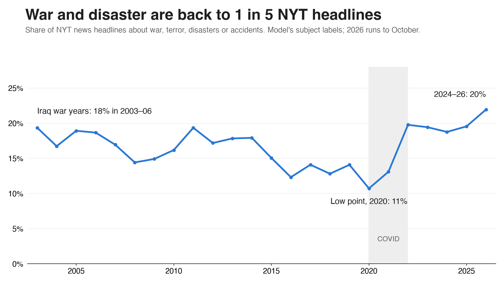
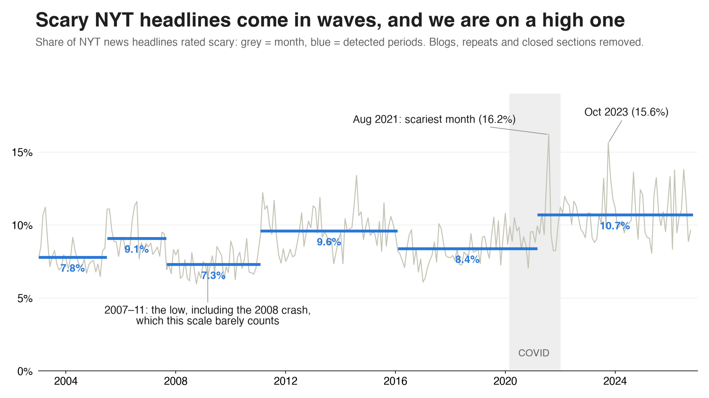

# Fear in the Headlines: Measuring News Fear on a Reader's Own Scale, 2003–2026

Rahheb Shaikh · Updated 3 November 2026 (results corrected after a data audit, see section 3.5) · Final report, project ongoing

## Abstract

Did the news become more frightening after COVID-19, and if so, why? We scored 3.35 million headlines from the New York Times (2003–2026), the Guardian (2003–2026) and ABC News Australia (2003–2021) for fear on a 0–3 scale defined by one reader's explicit codebook, which centres on danger to life and safety. A compact sentence model, distilled from a larger teacher trained on about 3,900 labelled headlines, reproduced codebook labels on unseen, scary-enriched sealed test sets with quadratic-weighted κ of .93 (2003–21 news) and .88 (2022–26 news), against κ .93 between two separate AI labelling passes. A post hoc data audit found that the NYT "news" base contained blog posts, same-day repeats and sections that closed or are not news, and this report's main results now use a corrected base. On it, the scary share of NYT news rose from 8.2% in 2017–19 to 10.7% in 2024–26 (+2.4 points, 95% CI 2.1 to 2.7); the Guardian rose 3.0 points (CI 1.9 to 3.9). War and disaster coverage rose from about 1 in 7 NYT news headlines to about 1 in 5, and about 93% of the rise since 2017 is agenda rather than framing. COVID produced a temporary spike in frightening health coverage that had faded by 2024. The rise is not a one-way climb: war and disaster were already 18% of NYT headlines in 2003–06, and scary coverage moves in waves. The rise is also sensitive to how news is defined: it is +1.0 point in print-only headlines and +1.5 without the NYT's quick-news and weather desks. All audit-based results are exploratory. We release the method, codebook and corrections so the measure can be reused.

## 1 Introduction

Headlines are the part of the news most people actually read, and a frightening headline shapes perceived risk even when the article beneath it is measured. Whether news has become more frightening matters for public anxiety, trust in media and how societies weigh real risks.

### 1.1 The problem with existing measures

Most large-scale studies measure sentiment or general negativity with lexicons or classifiers trained on generic emotion labels. Those tools confuse figurative harm ("a crushing defeat") with real threat, treat a court verdict over an old killing like the killing itself, and cannot say whose sense of fear they encode. We instead measure fear on an explicit, written scale anchored to one reader's judgement, and test the model against that scale on data it has never seen.

### 1.2 Research questions

1. **RQ1.** Did the share of frightening headlines change before, during and after COVID-19 (2017–2026)?
2. **RQ2.** Which subjects carry the frightening headlines, and did their share of coverage change?
3. **RQ3.** Is any change driven by agenda (which subjects are covered) or by framing (how frightening a given subject is made to sound)?

### 1.3 Contributions

- A written four-level fear codebook with tie-break rules, and a labelled corpus of about 3,900 headlines on that scale.
- An offline, phone-sized fear model (MiniLM, about 90 MB) that matches codebook labels closely on sealed tests, plus a 10-subject classifier sharing the same encoder.
- A scored analysis of 3.35 million headlines across three outlets and 24 years, and an analysis of the COVID era, planned in advance and later rerun on a corrected base, with day-clustered uncertainty and a shift-share decomposition.

## 2 Background

### 2.1 Negativity and fear in the news

Audiences attend more to negative news than to positive news (Soroka & McAdams, 2015; Trussler & Soroka, 2014), and negative words raise click-through on headlines (Robertson et al., 2023). Cultivation research argues that heavy exposure to violent media fosters a "mean world" view (Gerbner & Gross, 1976). Long-run studies of headline sentiment report rising negativity and fear-related emotion in US outlets from 2000 to 2019 (Rozado, Hughes & Halberstadt, 2022). These studies use generic sentiment or emotion labels; ours uses a fear-specific scale tied to real threat.

### 2.2 Agenda versus framing

Agenda-setting holds that the media shape what audiences think about by choosing what to cover (McCombs & Shaw, 1972). Framing concerns how a covered issue is presented (Entman, 1993). A rise in frightening headlines could come from either: more coverage of threatening subjects, or more alarming treatment of the same subjects. A shift-share decomposition separates the two.

### 2.3 Measuring emotion in text

Lexicon methods are cheap but blind to context, such as "shooting" in basketball, or a verdict long after a crime. Sentence encoders (Reimers & Gurevych, 2019) capture context; large encoders such as MPNet (Song et al., 2020) are accurate but heavy, and knowledge distillation (Hinton, Vinyals & Dean, 2015) transfers their judgements into small models such as MiniLM (Wang et al., 2020). Ordinal scales are best trained with ordinal-aware losses (Cao, Mirjalili & Raschka, 2020) and evaluated with weighted kappa (Cohen, 1968).

## 3 Data

### 3.1 Sources

| Source | Years | Headlines after deduplication | Access | Design |
| --- | --- | --- | --- | --- |
| New York Times | Jan 2003 – Oct 2026 | 1,818,830 | NYT Archive API | Full archive; news, opinion and other material types |
| ABC News (Australia) | Feb 2003 – Dec 2021 | 1,244,182 | Public "A Million News Headlines" dataset | Full set; ends 2021 |
| The Guardian | Jan 2003 – Oct 2026 | 289,833 | Guardian Content API | One random day per month (all topics) plus complete archives for 10 threat-related tags |
| HuffPost News Category | 2012 – 2022 | 210,000 | Public dataset, CC BY 4.0 (Misra, 2022) | Used only to train the subject classifier |

### 3.2 Collection

All data came through official APIs or openly licensed datasets, within published rate limits; no social-media platform was scraped. API responses were cached so every collection run is reproducible. The 2022–2026 extension was collected on 27 October 2026.

### 3.3 Deduplication

NYT and Guardian articles were deduplicated by article ID; Guardian random-day items without IDs, and ABC items, by date plus headline. A Guardian article reached by both the random-day and the tag designs is kept once, with both designs recorded. Headlines repeated five or more times within a source (for example "Corrections" or column names) are flagged as generic and excluded from the main analysis. Any headline used in training or in a test set was excluded from every other split.

### 3.4 Sampling designs and gaps

- Only the Guardian random-day sample is used for shares, because the tag archives deliberately over-sample threat topics.
- ABC ends in 2021, so post-COVID claims rest on the NYT and the Guardian.
- The NYT Archive API returned only about 700 articles for January 2026, against about 4,000 in a typical month, and 2026 runs to October.
- In 2025 the NYT changed its document-type label from "article" to "Article"; all filters are case-insensitive.

### 3.5 Data audit and corrected NYT base

An earlier version of this report used every NYT item typed "News". A reader's question about why 2008 looked so calm exposed the flaw: the scale barely counts financial panic, and about half of 2008's "news" items were blog-site posts, which are rarely scary. We then froze an audit plan (`docs/plans/data-audit.md`) and profiled the archive year by year. Fixes are post hoc, so everything that depends on them is exploratory.

**Corrected base.** From 1,282,901 NYT news headlines we removed 256,274 from outside www.nytimes.com (blogs and DealBook: 49% of 2008, 56% of 2012, near zero from 2017), 30,132 same-day repeats (30% of 2006) and 140,127 from Sports, Games, the Learning Network and Society, which closed or are not news. That leaves 856,368.

| Audit check | Finding | Effect on the 2017–19 to 2024–26 rise | Action |
|---|---|---|---|
| Blog sites and DealBook | Large in 2006–15, near zero after 2017 | None; it reshaped 2006–16 and the turning points | Removed |
| Same-day repeats | 30% of 2006, under 2% elsewhere | None | Removed |
| Sports desk closed in 2023 | 8.4 calm headlines a day fell to almost none | −0.56 points | Removed |
| Games, Learning, Society | Calm sections that grew or closed | +0.28, +0.07 and −0.22 points | Removed |
| Express (quick-news) desk and new Weather desk | Express began about 2017; Weather about 2023 | −1.0 point if excluded | Kept; reported |
| Print vs web | The rise is smaller in print | −1.4 points in print only | Kept; reported |
| Headlines became longer | NYT 7.3 words (2007–09) to 9.9; longer headlines score scarier | −0.5 points; large for long-run comparisons | Reported |
| Automated earthquake, map and tracker pages | Under 0.1% of headlines | None | No action |
| Wire-service bylines | At most 0.2% | None | No action |
| Gaps | Only Jan 2026 (7 days) and Oct 2026 (4 days) | None | No action |
| Seasonality | Same result on Jan–Sep only | None | No action |
| Scoring | No missing scores; rescored samples match to rounding | None | No action |
| NYT tags | Coverage steady at 81–88% | None | No action |
| Guardian | About 12 random days a year (9 in 2021 and 2026); sport share steady at 15–17% | None found, but the sample is thin | No action |
| ABC | Programme-type items at most about 3% | None | No action |

## 4 Measuring fear

### 4.1 The fear scale (codebook U1)

The question for every headline is: reading only this headline, how threatened or anxious would the reader feel? Levels are integers 0–3; when unsure between two levels, the lower is chosen.

| Level | Meaning | Typical cases | Example |
| --- | --- | --- | --- |
| 0 No fear | No threat to people | Sport, arts, procedure; rescued or found safe; figurative harm; animals only; natural-death obituaries | "Passengers escape plane inferno" |
| 1 Mild concern | Harm that is contained, distant or past | Court cases, charges and verdicts over killings; inquiries; aftermath and costs; drought | "Man who killed two women jailed" |
| 2 Clear fear | A real, current threat | A single accidental death; a missing person with the search ongoing; injuries; a fugitive on the run; large job losses | "River search fails to find missing driver" |
| 3 Alarm | Death that has happened, or mass danger | Several deaths; any violent death or shooting; mass-casualty disasters | "Car bomb kills 5 in Iraqi market" |

Headlines that sit between 2 and 3 (a search called off with people presumed dead, an explainer about a shooting) are scored 3 when labelled as integers; in analysis a model score of 2.5 or more counts as 3. Appendix A lists every rule.

### 4.2 Labelling and reliability

1. **Anchor ratings.** The reader rated 100 headlines by hand. A context check proposed 21 corrections where the reader lacked context (for example, a well-known disaster's death toll); the reader accepted all 21. The codebook was written from these ratings.
2. **Scale gap.** Generic AI raters scored about 0.44 levels higher than the reader on the same headlines (their 3 matched the reader's 2.2). This is why the model is trained on the reader's scale rather than on generic emotion labels.
3. **Corpus labels.** Further headlines were labelled with the codebook by an AI labeller (Claude), blind to all model scores, with doubtful cases collected and settled by the reader's rules. The training corpus holds about 3,900 headlines (3,118 train, 782 development, stratified by source and level).
4. **Reliability.** A separate AI labelling session, with the same codebook and no memory of the first labels, re-rated 150 headlines: exact agreement 86%, quadratic-weighted κ .93. This shows the rules give consistent answers. It isn't human agreement, and both passes may share blind spots.
5. **Check against the reader.** On the 20 of the reader's own hand ratings held out of training, the model scored κ .81 and 70% exact, and caught 4 of 7 scary items. The sample is small.

### 4.3 Model

The production model is small enough to run offline on a phone; a larger model supervises it during training.

1. **Teacher.** A sentence encoder (all-mpnet-base-v2; Song et al., 2020) fine-tuned with an ordinal (CORAL) head, a pairwise similarity loss and synthetic minimal pairs, which are edited headlines that change one factor, such as a death becoming a rescue. It is trained on the reader-scale labels (weight 2) plus earlier generic-rater labels (weight 0.5). Five seeds are averaged.
2. **Student.** MiniLM-L6 (Wang et al., 2020; inputs up to 32 tokens) distilled by mean-squared error on the teacher's scores for about 300,000 unlabelled ABC headlines, with the reader-scale labels added as direct targets (weight 3). A story-type head is trained jointly, and the final fear head is a ridge regression on the student's embeddings.
3. **Cut-points.** The continuous score is mapped to levels by three cut-points. The 1/2 cut maximises recall of scary headlines subject to at most 15% false alarms on "tricky calm" headlines (calm headlines containing harm words); the other two cuts maximise weighted κ. Cuts are tuned on the development set with 5-fold cross-validation; the final cuts are 0.625, 1.225 and 2.475, remapped to the level boundaries.

### 4.4 Subject classifier

Each headline also gets one of 10 subjects: war/terror, disaster/accident, crime/justice, health, economy, politics, environment, science/tech, sport, culture/lifestyle. Training labels come from the outlets' own metadata: NYT sections and subject keywords, Guardian sections and tags, and HuffPost categories, mapped by fixed rules (323,000 balanced headlines). A logistic-regression head on the same student encoder predicts the subject, so fear and subject come from one pass. On 193 hand-labelled headlines it is right 67% of the time (ABC 71%), and 85% when its confidence is at least 0.6, which holds for about half of headlines. The outlets' own tags agree with the hand labels 73% of the time.

## 5 Model evaluation

### 5.1 Protocol

- **Sealed test sets.** Each set holds 300 NYT headlines that no model had seen: 150 scary (level 2–3) and 150 calm, half of the calm ones "tricky" (they contain harm words). Candidates were drawn without any model, using a keyword pool plus a random draw. They were labelled blind on the codebook, locked, and opened once. Five sets were used over the project; sets #4 (2003–21) and #5 (2022–26) test the final model.
- **Frozen plans.** Every training change, gate and comparison was written down before its numbers were computed. A model replaced its predecessor only if it passed the pre-set gates on a sealed set.
- **Enrichment.** The sets are half scary, while ordinary news is about 10% scary, so these figures don't describe everyday accuracy. Section 5.4 does.
- **Metrics.** Quadratic-weighted κ against the labels; exact level accuracy, overall and per level; recall and precision of scary headlines; the false-alarm rate on tricky calm headlines; AUC for scary versus calm.

### 5.2 Results

| Metric | Sealed #4 (NYT 2003–21) | Sealed #5 (NYT 2022–26) |
| --- | --- | --- |
| Weighted κ | .93 | .88 |
| Exact level | 81% | 77% |
| True 0 / 1 / 2 / 3 right | – / 48% / 77% / 83% | 95% / 55% / 69% / 78% |
| Scary headlines caught (recall) | 94% | 87% |
| Precision of "scary" | 92% | 87% |
| False alarms on tricky calm | 17% | 23% |
| AUC, scary vs calm | .98 | .95 |

The final model (v7e) cuts the exact-level error from 60% to 19% compared with the earlier grammar-and-encoder model (v6), which scored κ .60, 40% exact and 41% false alarms on sealed #4. Appendix B lists every step in between.

### 5.3 Errors

- **Mild news is the weak level.** About a third of true level-1 headlines (court cases, aftermath, distant tension) are rated 2. In a 600-headline sample of 2022–26 headlines picked near the model's 1/2 boundary, 154 of the 337 it rated 2 were true 1s.
- **Newer news is harder.** Agreement drops from κ .93 to .88 on 2022–26 headlines, plausibly because of new topics (the wars in Ukraine and Gaza, the 2026 Iran war) and newer headline styles.
- **Two fixes were tried and rejected on sealed #5.** Retraining on 197,000 recent headlines plus 600 new labels (v7f) caught more scary news (91%) but got fewer 1s right (38%). Raising the 1/2 cut-point got more 1s right (66%) but missed more scary news (81%). Neither passed the pre-set bar, so v7e was kept.

### 5.4 Accuracy on the ordinary news mix

Sealed items were drawn from keyword-matched and non-keyword headlines, so reweighting them by each group's real share of NYT headlines estimates ordinary-news performance. An earlier version of this report treated the non-keyword items alone as a random sample, which was wrong and has been corrected here.

| Pool | True scary share | Model's scary share | Weighted recall | Weighted precision |
|---|---|---|---|---|
| Sealed #4 (2003–21) | 3.0% | 5.5% | 96% | 51% |
| Sealed #5 (2022–26) | 9.3% (95% CI 4.9 to 14.5) | 10.2% | 60% | 55% |

The model's overall share is close to the labels for recent news and too high for older news. So overall shares are usable, but on ordinary news only about half of individually flagged headlines are truly scary. These estimates are rough, because few non-keyword items were scary (5 in sealed #5). They were not recomputed on the corrected base: 42 of the 300 items in sealed #4 came from blog sites and 10 from removed sections, while sealed #5 had no blog items and 7 from removed sections, so the older estimate may not describe the corrected base.

## 6 Results

Periods and methods follow a plan frozen before any number was computed: pre-COVID 2017–19, COVID 2020–21, after 2022–23, recent 2024–26, with 95% day-clustered bootstrap intervals (1,000 resamples). The corrected NYT base (section 3.5) was added after results were seen, so NYT results here are exploratory. Guardian and ABC results are unchanged.

### 6.1 Trends over time (RQ1)

The NYT moves in waves: about 8–9% in 2003–07, about 7–8% in 2008–10, about 9–10% in 2011–15, about 8% in 2016–18, and about 10–11% since 2021. The Guardian jumps in 2020 and settles about 3 points above its pre-COVID level. ABC, whose data end in 2021, rises from 2017 onward. Each outlet has its own baseline, so changes, not levels, are compared.

A daily view shows why this can feel constant. In 2024–26, NYT news carried at least one scary headline on 100% of the 984 days with data, averaging 9.8 a day (median 9), up from 7.2 a day in 2017–19. About 89% of its news headlines were still not scary. This daily view is descriptive only.

### 6.2 Before, during and after COVID

| Sample | Pre-COVID 2017–19 | COVID 2020–21 | After 2022–23 | Recent 2024–26 | Recent minus pre (95% CI) |
| --- | --- | --- | --- | --- | --- |
| NYT news, scary (2–3) | 8.2% | 9.7% | 10.9% | 10.7% | +2.4 (2.1 to 2.7) |
| NYT news, alarm (3) | 1.9% | 1.7% | 2.2% | 2.3% | +0.4 (0.2 to 0.5) |
| Guardian, scary (2–3) | 5.9% | 10.3% | 8.7% | 8.9% | +3.0 (1.9 to 3.9) |
| Guardian, alarm (3) | 1.0% | 1.3% | 1.4% | 1.5% | +0.5 (0.2 to 0.9) |
| NYT opinion, scary (2–3) | 2.1% | 2.9% | 2.5% | 1.9% | −0.2 (−0.5 to 0.1) |

News became scarier and stayed scarier at both outlets. Opinion headlines rose during COVID and then returned to baseline.

### 6.3 Subjects (RQ2)

| Subject, NYT news | Share of headlines 2017–19 | 2020–21 | 2022–23 | 2024–26 | Scary within subject 2017–19 | 2024–26 |
| --- | --- | --- | --- | --- | --- | --- |
| War / terror | 8.8% | 6.7% | 13.2% | 12.7% | 31% | 32% |
| Disaster / accident | 4.9% | 5.1% | 6.4% | 7.2% | 46% | 50% |
| Crime / justice | 9.2% | 8.0% | 9.4% | 9.2% | 26% | 23% |
| Health | 6.4% | 17.1% | 7.6% | 5.6% | 6% | 8% |
| Politics | 17.0% | 15.8% | 13.4% | 18.9% | 1% | 1% |
| Economy | 10.2% | 9.1% | 9.8% | 8.8% | 1% | 1% |
| Culture / lifestyle | 27.0% | 22.1% | 23.1% | 20.7% | 0% | 0% |

Four subjects carry almost all frightening headlines: disaster/accident (about half of its headlines are scary), war/terror and crime/justice (about a quarter to a third each), and health during COVID (16% scary in 2020–21). War and disaster together rose from 13.7% to 19.9% of NYT news, or 12 to 18 headlines a day. By the outlet's own tags the rise is steeper, from 10.3% to 21.3%. They produced 72% of scary headlines in 2024–26, up from 60%. Health returned to its pre-COVID share by 2024–26. The Guardian shows the same pattern: war/terror rose from 5.6% to 9.9% of headlines and disasters from 3.0% to 3.8%.

### 6.4 Agenda or framing? (RQ3)

A shift-share decomposition splits the change in the scary share into agenda (subject shares change, scariness held at pre-COVID levels), framing (scariness within subjects changes, shares held) and their interaction. For NYT news the +2.41-point rise splits into agenda +2.25, framing +0.08 and interaction +0.08, so about 93% is agenda. For the Guardian the +2.95-point rise splits into agenda +1.96, framing +0.77 and interaction +0.22, so about two-thirds is agenda. For NYT opinion the total change is about −0.2 points, with no meaningful component.

### 6.5 Long view

ABC's scary share was 12–14% from 2003 to 2009, fell to about 10.5% in 2012–14, and then climbed to 14.0% in 2019, 16.0% in 2020 and 18.0% in 2021.

Long-run comparisons need care, because headlines got longer and longer headlines score scarier. The table shows each share as measured and with headline length held at each outlet's 2017–19 mix.

| Outlet | Period | Words per headline | Scary share | Length held fixed |
|---|---|---|---|---|
| NYT | 2003–06 | 7.8 | 8.4% | 10.6% |
| NYT | 2007–09 | 7.3 | 7.5% | 9.4% |
| NYT | 2017–19 | 9.6 | 8.2% | 8.2% |
| NYT | 2024–26 | 9.9 | 10.7% | 10.2% |
| Guardian | 2003–06 | 5.7 | 3.8% | 6.0% |
| Guardian | 2017–19 | 10.7 | 5.9% | 5.9% |
| Guardian | 2024–26 | 12.8 | 8.9% | 8.3% |
| ABC | 2003–06 | 6.3 | 12.2% | 12.3% |
| ABC | 2021 | 7.9 | 18.0% | 18.0% |

At the NYT, today's level is the highest as measured, but not once length is held fixed. War and disaster were 18.4% of NYT headlines in 2003–06 and 19.9% in 2024–26. So we do not claim a 24-year high at the NYT. The Guardian and ABC are higher than their early years on both measures.

### 6.6 Robustness

| NYT news base | 2017–19 | 2024–26 | Rise (95% CI) |
|---|---|---|---|
| Original base (earlier report) | 7.1% | 10.1% | +3.0 (2.7 to 3.3) |
| Without blogs and DealBook | 7.1% | 10.1% | +3.0 (2.7 to 3.3) |
| **Corrected base (main)** | **8.2%** | **10.7%** | **+2.4 (2.1 to 2.7)** |
| Corrected, length held fixed | 8.2% | 10.2% | +2.0 |
| Corrected, no Express or Weather desks | 7.8% | 9.2% | +1.5 (1.1 to 1.8) |
| Corrected, print-only articles | 8.2% | 9.2% | +1.0 (0.6 to 1.4) |
| Same print articles, rescored on print headlines (25,000 a period) | 7.8% | 8.8% | +1.0 |
| Corrected, no politics desks | 8.7% | 11.9% | +3.3 (2.9 to 3.7) |

The direction holds in every version, but the size ranges from about 1 to 3 points. War and disaster's rise is steadier: 14.1% to 18.6% in print and 13.6% to 18.9% without Express and Weather. The Guardian's original checks are in `docs/results-covid.md`.

### 6.7 Key transitions (exploratory)

The original change-point method was rerun on monthly shares of the corrected base.

| Period | Scary share | War and disaster share |
|---|---|---|
| Jan 2003 – Jun 2005 | 7.8% | 18.0% |
| Jul 2005 – Aug 2007 | 9.1% | 18.8% |
| Sep 2007 – Jan 2011 | 7.3% | 15.3% |
| Feb 2011 – Jan 2016 | 9.6% | 17.3% |
| Feb 2016 – Feb 2021 | 8.4% | 12.7% |
| Mar 2021 – Oct 2026 | 10.7% | 18.8% |

Dates depend on the base, so we rely only on what repeats. The rise in February 2011 and the fall in early 2016 appear in the corrected, print-only and blog-free bases. The latest step does not have a stable date: March 2021 here, December 2019 in print only, and July 2019 in the blog-free base. So the data do not establish whether it began before COVID. The earlier report's "brief 2011 spike", "March 2014 step" and "July 2019 step, before COVID" were affected by the base and are withdrawn. The scariest months are August 2021 (16.2%; Kabul and wildfires) and October 2023 (15.6%; Gaza). Their order swaps across bases.

The 2007–11 low was far deeper in the earlier report (3.5%) because of blogs. Much of what remains may reflect the scale: of 938 NYT headlines with crash-related words from 14 September to 31 October 2008, 96% scored 0 or 1, because financial fear is largely outside this scale. These data don't show that 2008 was a calm year.

### 6.8 Checks on the rise (exploratory)

- **Is it just fewer calm headlines?** No. On the corrected base, scary headlines rose from 7.2 to 9.8 a day (+35%) and calm ones were about flat (80.6 to 82.3).
- **Where do the extra scary headlines come from?** About 2.6 more a day. Nearly half (46%) come from the Express quick-news desk (0.7 to 1.6 a day) and a new Weather desk (0 to 0.3), and about 29% from Foreign (3.6 to 4.3). A spot check of Weather headlines flagged as scary included some routine forecasts, so the model may overstate this desk. National was flat and Metro fell slightly. Desks can be reorganised, so some of this may be stories moving between desks rather than new coverage.
- **Print vs web.** In print-only articles the share rose 1.0 point and scary headlines fell slightly per day (5.6 to 5.2), as the paper published less. Much of the rise is in web-only reporting. The print flag may be incomplete for recent months.
- **Does it depend on the model?** Blind labels alone, across all NYT article types, also show a rise, from 4.2% (2017–19, CI 2.5 to 7.3) to 11.0% (2024–26, CI 5.5 to 18.1): +6.7 points, CI 0.3 to 14.4. The direction agrees with the model, but the size is very uncertain. Labelling rules were refined between pools, which could affect this comparison, and this check was not rerun on the corrected base.
- **Is tone really flat?** Since 2017, yes: framing adds +0.08 of the 2.41-point rise. From 2003–06 to 2024–26 framing appears larger (+1.40 of 2.26 points), but headline length changed over that span, so tone and style can't be separated.
- **Could the shared encoder bias subjects?** Partly. The fear and subject heads use one encoder, and model subjects match outlet tags more often for scary headlines. But the rise in war and disaster is stronger, not weaker, using the tags alone.

## 7 Discussion

### 7.1 What changed, and what did not

Since 2017–19 the share of scary NYT headlines rose by about 2.4 points, and has stayed up since the pandemic ended. Tone within subjects has barely moved in that time. What changed is the mix: war and disaster rose from about 1 in 7 NYT news headlines to about 1 in 5.

That rise needs context in two ways. First, it starts from a low. War and disaster were about 18% of NYT headlines in 2003–06, during the Iraq war, and about 13% in 2016–21. The pattern is closer to waves than to a steady climb. Second, part of it is how the NYT publishes: a quick-news desk and a weather desk carry nearly half of the extra scary headlines, and print headlines show a smaller rise.

These data measure coverage, not events. They can't say whether the world became more dangerous, whether newsrooms gave danger more attention, or both. Outside evidence suggests events are part of it: the Uppsala Conflict Data Program recorded 61 active state-based conflicts in 2024, the most since 1946, although deaths did not set a record (PRIO, 2025). Testing coverage against event data is the most important open question.

### 7.2 COVID as a spike, not a shift

COVID-19 raised fear through one subject, health, which both took more space and became more alarming. Both effects reversed by 2024, and the lasting rise is carried by war and disaster, which were at their lowest during COVID. Whether the upturn began just before the pandemic can't be settled, because its date depends on the base (section 6.7). Accounts that blame a post-COVID "anxiety culture" in the press are not supported by these headlines.

### 7.3 News versus opinion

Opinion headlines rose only during COVID and then returned to their pre-COVID level. The lasting rise is in reporting of events, which fits an agenda explanation better than a deliberate change in editorial voice.

### 7.4 Measuring on a reader's scale

A scale written from one reader's judgement makes the measure explicit and testable: anyone can read the codebook, disagree with a rule, and re-label. Generic raters scored about half a level more fearful than our reader, which would inflate absolute levels but, because the bias is roughly constant, should leave trends similar. Agreement on sealed sets suggests a compact, offline model can apply a written scale consistently in aggregate, although individual flags on ordinary news are much less reliable (section 5.4).

## 8 Limitations

- **One reader's scale.** Levels reflect one person's codebook. Other readers may draw the lines elsewhere; the codebook makes the choices visible but does not make them universal.
- **AI-assisted labels.** Most corpus labels were produced by an AI labeller following the codebook. The κ .93 consistency check compared two AI sessions, not people, and direct comparison with the reader's own ratings is limited to 20 held-out items.
- **Headlines only.** Article text, images, placement and reach are not measured, so the results describe what headlines signal, not what readers saw most.
- **Coverage after 2021.** Only the NYT and the Guardian extend past 2021, and both are English-language, centre-left outlets. Other outlets, and television or social platforms, may differ.
- **Model error over time.** Accuracy is lower on 2022–26 news (κ .88). Trends assume errors are stable across years. The check in section 5.4 suggests the model overstates older news more than recent news, which would make the true rise larger, but those estimates are rough.
- **Coverage is not reality.** These data can't separate changes in world events from changes in newsroom attention.
- **Individual headlines.** On ordinary news, only about half of headlines the model flags as scary are truly scary. Results are meant for aggregate use.
- **Subject error.** About one subject in three is wrong. The main conclusion holds with the outlets' own tags, but finer subject comparisons should be read with care.
- **Scope of fear.** The scale centres on danger to life and safety. Financial panic, such as the 2008 crash, barely registers, so "scary" here does not mean everything people fear.
- **Post hoc corrections.** The corrected base was chosen after results were seen, and other reasonable bases give a rise of about 1 to 3 points. Removing blog sites also removed some real reporting (such as The Lede and City Room), which may understate 2007–15 somewhat. Model training and sealed tests used the original pools.
- **Changing formats.** Longer headlines, web-first publishing and desk reorganisations all affect these measures, and long-run comparisons are the most exposed. Placement and readership were not audited.
- **Collection artefacts.** January and October 2026 are under-collected at the NYT, 2026 is partial, and the Guardian sample covers only about 12 days a year.

## 9 Ethics, data and code availability

- **Data.** Only published headlines and outlet metadata were used, collected through official APIs within their terms or from openly licensed datasets. No personal data and no social-media posts were collected.
- **Redistribution.** NYT and Guardian headline text is subject to their API terms; this repository shares code, the codebook and aggregate results, and NYT and Guardian headlines can be re-fetched from the same APIs. Other cleaned data, scores and labels are available on request (see `DATA_ACCESS.md`). ABC and HuffPost datasets are public.
- **Labelling.** No crowd workers were used. The reader's own ratings anchor the scale; AI-assisted labels are disclosed above.
- **Intended use.** The measure describes coverage. It should not be used to rank or penalise individual journalists or articles.

## 10 Conclusion

Across 3.35 million headlines, scary news rose after 2017–19 at both the NYT (+2.4 points) and the Guardian (+3.0), and it has not come down. COVID-19 drove a temporary spike in frightening health news, while the lasting rise comes from what is covered: war and disaster went from about 1 in 7 NYT news headlines to about 1 in 5. This is a wave rather than a one-way climb, returning to a level last seen during the Iraq war years, and it is sensitive to publishing format, with a smaller rise in print. Whether it reflects a more dangerous world or more attention to danger is the next question. A year-by-year data audit changed several of this project's earlier conclusions, which is the main methodological lesson. A compact offline model trained on an explicit fear scale can track this in aggregate, as long as what counts as news is held constant.

## References

- Cao, W., Mirjalili, V., & Raschka, S. (2020). Rank consistent ordinal regression for neural networks with application to age estimation. *Pattern Recognition Letters, 140*, 325–331.
- Cohen, J. (1968). Weighted kappa: Nominal scale agreement with provision for scaled disagreement or partial credit. *Psychological Bulletin, 70*(4), 213–220.
- Entman, R. M. (1993). Framing: Toward clarification of a fractured paradigm. *Journal of Communication, 43*(4), 51–58.
- Gerbner, G., & Gross, L. (1976). Living with television: The violence profile. *Journal of Communication, 26*(2), 172–199.
- Hinton, G., Vinyals, O., & Dean, J. (2015). Distilling the knowledge in a neural network. arXiv:1503.02531.
- Kulkarni, R. (2018). *A Million News Headlines* (Version 6.0) \[Data set\]. Harvard Dataverse. https://doi.org/10.7910/DVN/SYBGZL
- McCombs, M. E., & Shaw, D. L. (1972). The agenda-setting function of mass media. *Public Opinion Quarterly, 36*(2), 176–187.
- Misra, R. (2022). News Category Dataset. arXiv:2209.11429.
- PRIO (2025). *Conflict Trends: A Global Overview, 1946–2024*. Peace Research Institute Oslo. https://www.prio.org/publications/14453
- Reimers, N., & Gurevych, I. (2019). Sentence-BERT: Sentence embeddings using Siamese BERT-networks. *Proceedings of EMNLP-IJCNLP 2019*, 3980–3990.
- Robertson, C. E., Pröllochs, N., Schwarzenegger, K., Pärnamets, P., Van Bavel, J. J., & Feuerriegel, S. (2023). Negativity drives online news consumption. *Nature Human Behaviour, 7*(5), 812–822.
- Rozado, D., Hughes, R., & Halberstadt, J. (2022). Longitudinal analysis of sentiment and emotion in news media headlines using automated labelling with Transformer language models. *PLOS ONE, 17*(10), e0276367.
- Song, K., Tan, X., Qin, T., Lu, J., & Liu, T.-Y. (2020). MPNet: Masked and permuted pre-training for language understanding. *Advances in Neural Information Processing Systems 33*.
- Soroka, S., & McAdams, S. (2015). News, politics, and negativity. *Political Communication, 32*(1), 1–22.
- Trussler, M., & Soroka, S. (2014). Consumer demand for cynical and negative news frames. *The International Journal of Press/Politics, 19*(3), 360–379.
- Wang, W., Wei, F., Dong, L., Bao, H., Yang, N., & Zhou, M. (2020). MiniLM: Deep self-attention distillation for task-agnostic compression of pre-trained Transformers. *Advances in Neural Information Processing Systems 33*.

Data services: The New York Times Archive API; The Guardian Open Platform (Content API). Reference details were checked against Crossref, arXiv and DataCite on 3 November 2026.

## Appendix A: Codebook rules in full

- **0:** no threat to people; sport, arts, procedure; rescued, found safe or escaped; figurative harm words ("fights for life after poll thrashing"); animals only; history pieces; obituaries for old age or natural death; a fugitive who has been caught.
- **1:** an investigation, inquiry, hearing or inquest after harm; aftermath and costs; a contained fire; drought; tension or threats far away; crime with a victim but no ongoing danger; charges, trials, verdicts or executions over killings, even mass or old ones.
- **2:** a single accidental death, a child included; a missing person with the search ongoing; a bombing with likely casualties; injuries; a child's suspicious death; hundreds of local jobs lost or large layoffs; an ongoing local emergency; a fugitive still on the run; an aftermath piece about a known attack that names no death.
- **3:** several deaths, accidental or not, stated as fact; any violent death, shooting or critical wounding by violence, including of militants or suspects and of a single civilian far away; many people missing with live danger; mass-casualty disasters.
- **Tie-breaks:** use context the reader would have (a well-known disaster carries its toll); if the threat is over, score the remaining worry; if torn between two levels, choose the lower; near-death cases that are not a stated death (search called off, presumed dead) are 2.5–2.8 and count as 3.

## Appendix B: Model development history

| Model | Change | Key test result | Decision |
| --- | --- | --- | --- |
| v6 | Grammar rules + MiniLM, trained on disaster labels | Sealed #4: κ .60, 40% exact | Earlier baseline |
| v10 (teacher) | MPNet with ordinal head and synthetic minimal pairs | Sealed #1: AUC .97, 65% of 3s caught | Became the teacher |
| v7 | MiniLM student, smooth calibration to the reader | Sealed #1: only 28% of 3s caught (calibration flattened the top) | Replaced |
| v7b | Level cut-points instead of calibration | Sealed #3: κ .83, 75% of 2–3s caught | Made default |
| v7c | + 600 labels near the 1/2 boundary | Sealed #4: κ .85, 53% of true 2s right | Made default |
| v7d | + 300 accident and rescue labels | Development κ .81 (gate failed) | Rejected |
| v7e | Teacher retrained directly on the reader's scale | Sealed #4: κ .93; sealed #5: κ .88 | **Final model** |
| v7f | + 197,000 recent headlines and 600 new labels | Sealed #5: κ .88, but only 38% of 1s right | Rejected |

## Appendix C: Reproducibility

1. **Collection:** `outlets_fetch.py`, `guardian_targeted.py`, `recent_fetch.py` (APIs, cached and resumable).
2. **Labels and tests:** `prep_scary_test*.py` (sealed pools), `prep_v7f_data.py`, `build_u1_corpus.py`.
3. **Models:** `train_v12.py` (teacher), `build_fear_v7e.py` (student), `build_subject.py` and `build_subject_rules.py` (subjects).
4. **Scoring and analysis:** `score_all_v7e.py` (3.35 million rows), `analysis_covid.py` (frozen plan, 1,000 day-cluster bootstrap resamples, seed 0), `analysis_transitions.py` and `analysis_transitions2.py` (exploratory, on the original base), and `analysis_corrected.py` (corrected base; main NYT results, exploratory).

The production model runs on CPU with no network access; scoring all 3.35 million headlines took 16 minutes on a laptop.
